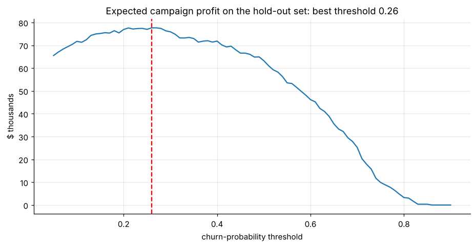
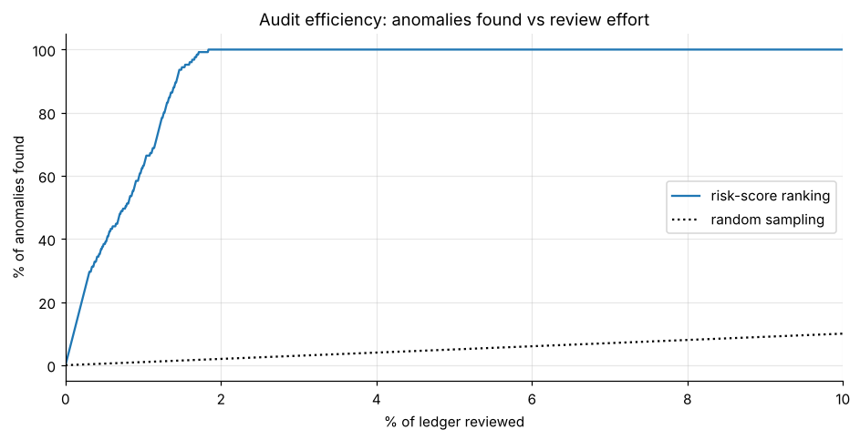
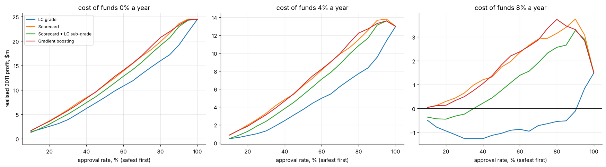
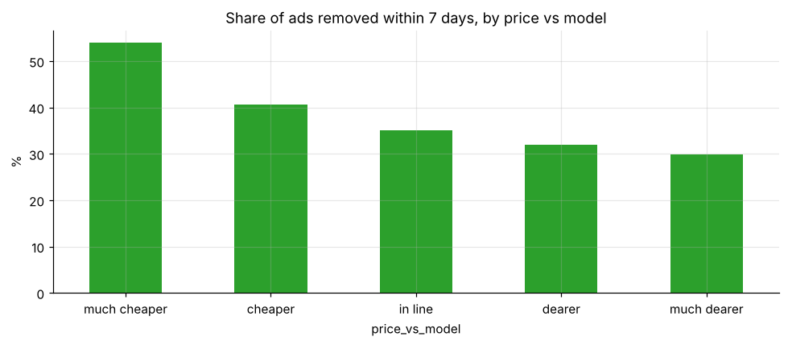

# Data Science & Business Analytics Portfolio

Applied data-science projects focused on the questions **finance leaders and business owners** ask: whom should we lend to, which invoices should not be paid, who will churn and is it worth saving them, how healthy is recurring revenue, what is our currency exposure, which journal entries should audit look at, what will demand be next quarter, and what does the sales database say. Each project is a single executed notebook with its data, charts and plain-language recommendations.

| Project | Summary |
|---|---|
| [Customer churn prediction & profit-optimal retention](projects/01-customer-churn-prediction) | Telco churn (7,043 customers): EDA of churn drivers, logistic regression vs gradient boosting (ROC-AUC ≈ 0.85), cumulative gains, and a **profit curve** that picks who gets a retention offer. The best policy contacts 41% of customers and **doubles** campaign profit compared with contacting everyone. |
| [SaaS subscription metrics](projects/02-saas-subscription-metrics) | MRR, new vs churned MRR, logo churn, **cohort retention** heatmap and LTV by plan from 10,497 subscriptions. Annual plans carry about **3× the lifetime value** of monthly plans. |
| [Net Promoter Score with bootstrap confidence intervals](projects/03-net-promoter-score) | Monthly NPS with 95% bootstrap CIs, showing which month-to-month moves are real and which are sampling noise. |
| [SMS spam classifier (NLP)](projects/04-sms-spam-classifier) | Word + character n-gram TF-IDF with Naive Bayes, logistic regression and a linear SVM; **99% accuracy, 0.99 spam precision** on hold-out data; the trained pipeline is saved to `model/`. |
| [Pakistan Stock Exchange: risk & moving-average strategies](projects/05-psx-stock-analysis) | Six PSX stocks plus Apple: risk, correlation and drawdowns, then dual moving-average strategies with parameters chosen **in-sample** and judged **out-of-sample**, net of costs. Mixed results that show how single-sample backtests mislead. |
| [SQL business analytics (Chinook)](projects/06-sql-business-analytics) | Eight business questions in SQL: revenue by genre and country, running totals and MoM growth with **window functions**, sales-rep ranking, **RFM segmentation**, album-vs-track purchasing and catalogue utilisation. |
| [Monthly temperature trends, 1901-2017](projects/07-climate-temperature-trends) | Reshaping, seasonality, warming trend with autocorrelation-robust (Newey-West) CIs: **0.4 °C/century before 1960 vs 2.2 °C/century after**, plus a decadal anomaly heatmap. |
| [House-price valuation model (Ames, Iowa)](projects/08-house-price-valuation) | Automated valuation of 2,930 home sales: ridge, lasso and gradient boosting on log prices with 5-fold CV; **median error ≈ 5%**, 78% of valuations within 10% of the sale price; value drivers and error by price segment. |
| [Currency risk: ECB euro reference rates, 1999-2021](projects/09-fx-rate-risk) | Volatility regimes, correlations and tail events (e.g. the 2015 Swiss franc de-peg), then a 10-day 99% **VaR of a multi-currency receivables book** vs its worst historical loss (about 4-5× larger). |
| [Demand forecasting: daily bike-sharing rentals](projects/10-demand-forecasting) | Calendar + weather regression vs seasonal-naive baselines on a 6-month hold-out; **22% lower error than the naive forecast**; why tree models fail to extrapolate growth, and why WAPE beats MAPE. |
| [App-market analysis: Google Play Store](projects/11-app-market-analysis) | Cleaning messy text fields, then competition vs demand by category, free vs paid economics (paid apps: median 1k installs vs 100k free) and niche opportunities. |
| [Audit analytics: journal-entry testing](projects/12-audit-analytics-journal-entries) | Full-population GL testing on a **synthetic ledger**: Benford's law, weekend/after-hours/round-amount/below-threshold/duplicate rules and an Isolation Forest risk score. Reviewing **1.8% of entries catches 100% of planted anomalies**. |
| [Credit-risk scorecard (LendingClub)](projects/13-credit-risk-scorecard) | Bank-style PD scorecard on 41,519 loans: WoE/IV binning, a logistic model converted to points, **out-of-time** validation on 2011, PSI monitoring. Using application data only, it reaches **AUC 0.695 vs 0.670** for LendingClub's own grade. A profit-based cut-off at an 8% cost of funds earns **$3.7m vs $1.5m** for approving everyone. |
| [Accounts-payable automation](projects/14-ap-invoice-automation) | Invoice PDF extraction (three vendor layouts), three-way match against POs and receipts, duplicate and **changed-bank-details** fraud checks, vendor query drafts and a payment-run plan. **100% field accuracy**, all 20 planted problems caught with no false positives, 73% straight-through processing (synthetic data). |
| [Recommender system (TMDB 5000)](projects/15-movie-recommender) | Bayesian weighted-rating charts plus content-based recommendations (plot TF-IDF + metadata), evaluated **offline with held-out keywords**: **5.7×** the relevance of random picks. Includes a tunable relevance-vs-quality hybrid. |
| [Data-engineering job market](projects/16-data-job-market) | Skill extraction from 2,388 Glassdoor postings and a log-salary regression with company-clustered errors. Python and SQL are the baseline; **location dominates pay**, and skill premia are small and fragile after a multiple-testing correction. |
| [Used-car pricing & depreciation](projects/17-used-car-pricing) | Auditable cleaning of 50,000 messy marketplace listings, a depreciation model with brand-specific rates (R² 0.83, about 14-16% a year at age 5), and **price vs time-to-sell**: under-priced ads go within a week 54% of the time vs 30% for over-priced ones. |
| [Venture funding + data engineering (Crunchbase)](projects/18-venture-funding-data-engineering) | Larger-than-memory techniques (dtype optimisation −90%, verified chunked aggregation, SQLite batch loads, SQL window functions and self-joins). Catches a **3.3× double-counting** error; maps the 2005-2013 angel boom and the co-investor network. |

  
  
  
  

## Skills shown
**Python** (pandas, NumPy, scikit-learn, statsmodels, matplotlib/seaborn) · **SQL** (CTEs, window functions, self-joins, RFM; SQLite) · **credit risk** (WoE/IV scorecards, PD, KS/Gini, PSI, profit cut-offs) · **finance automation** (PDF extraction, three-way match, duplicate and fraud controls) · recommender systems · larger-than-memory data engineering (dtypes, chunking) · regression with clustered errors · classification and model evaluation (ROC/PR, cross-validation, calibration to business value) · **NLP** (TF-IDF, linear models) · **SaaS/finance KPIs** (MRR, churn, cohorts, LTV, NPS) · time-series forecasting & trend inference · **audit analytics** (Benford, JE testing, anomaly detection) · FX risk / VaR · honest out-of-sample backtesting

## More quantitative-finance work
* [derivatives-pricing-toolkit](https://github.com/drimranbhatti/derivatives-pricing-toolkit): Black-Scholes, Heston, Merton, Bates, calibration
* [portfolio-optimization-lab](https://github.com/drimranbhatti/portfolio-optimization-lab): Markowitz, Black-Litterman, HRP, Kelly
* [market-risk-models](https://github.com/drimranbhatti/market-risk-models): VaR/ES backtesting, HMM regimes, Bayesian networks
* [covid-market-impact-research](https://github.com/drimranbhatti/covid-market-impact-research): contagion, GARCH, Diebold-Yilmaz spillovers
* [dea-panel-econometrics](https://github.com/drimranbhatti/dea-panel-econometrics): DEA efficiency, Malmquist, FE/RE panels
* [crypto-deep-learning-trading](https://github.com/drimranbhatti/crypto-deep-learning-trading) · [ml-finance-models](https://github.com/drimranbhatti/ml-finance-models)

## Data sources
IBM Telco Customer Churn sample · UCI SMS Spam Collection · Ames Housing (De Cock, 2011) · ECB euro reference rates · UCI Bike Sharing · Google Play Store apps (Kaggle) · a synthetic general ledger generated in-notebook · LendingClub 2007-2011 loan data · synthetic invoice PDFs (generated) · TMDB 5000 (The Movie Database) · Glassdoor data-engineer postings (Kaggle) · eBay Kleinanzeigen used cars · Crunchbase 2013 snapshot · Chinook sample database (L. Rocha) · PSX historical prices · public course datasets (subscriptions, NPS, monthly temperatures). Datasets are included for reproducibility and belong to their respective owners.

---
**Dr. Muhammad Imran Bhatti, PhD** · Finance & AI · [LinkedIn](https://www.linkedin.com/in/drimranbhatti) · [imranbhatti.com](https://imranbhatti.com) · MIT licensed (code)
