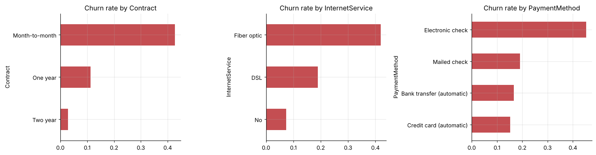
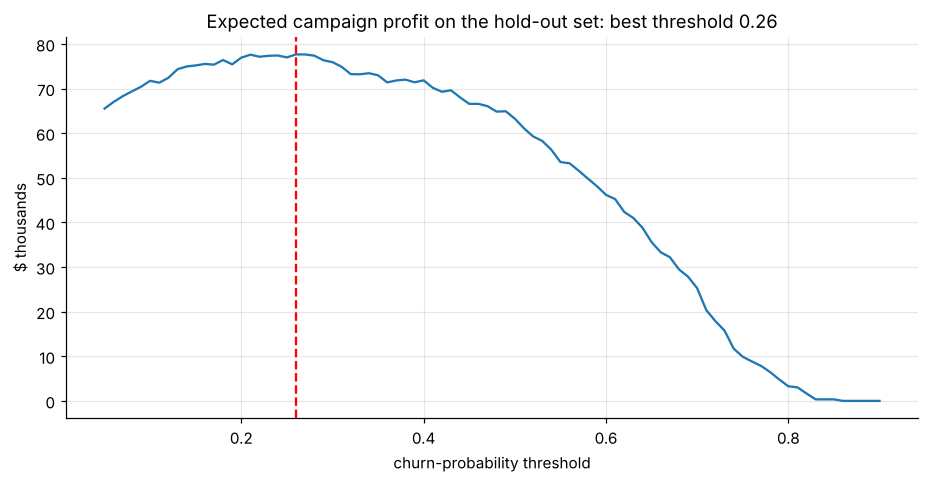

# Customer churn prediction & profit-optimal retention

Telco churn (7,043 customers): EDA of churn drivers, logistic regression vs gradient boosting (ROC-AUC ≈ 0.85), cumulative gains, and a **profit curve** that picks who gets a retention offer. The best policy contacts 41% of customers and **doubles** campaign profit compared with contacting everyone.





**Notebook:** [analysis.ipynb](analysis.ipynb) (executed, outputs included)

```bash
pip install -r ../../requirements.txt
jupyter lab analysis.ipynb
```
