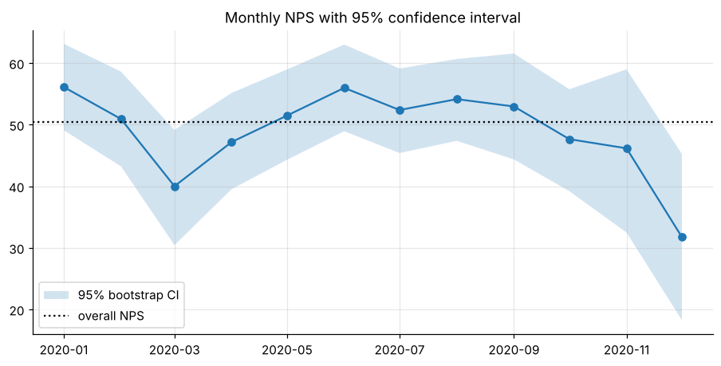

# Net Promoter Score with bootstrap confidence intervals

Monthly NPS with 95% bootstrap CIs, showing which month-to-month moves are real and which are sampling noise.



**Notebook:** [analysis.ipynb](analysis.ipynb) (executed, outputs included)

```bash
pip install -r ../../requirements.txt
jupyter lab analysis.ipynb
```
