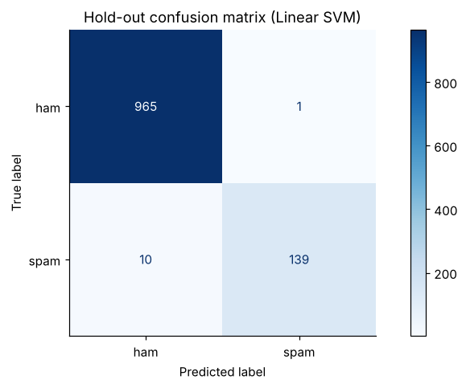

# SMS spam classifier (NLP)

Word + character n-gram TF-IDF with Naive Bayes, logistic regression and a linear SVM; **99% accuracy, 0.99 spam precision** on hold-out data; the trained pipeline is saved to `model/`.



**Notebook:** [analysis.ipynb](analysis.ipynb) (executed, outputs included)

```bash
pip install -r ../../requirements.txt
jupyter lab analysis.ipynb
```
