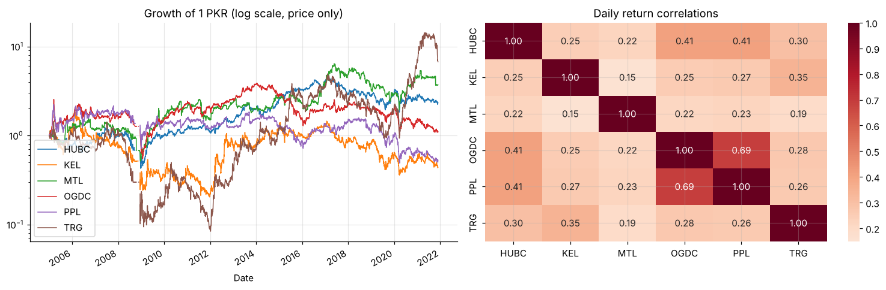
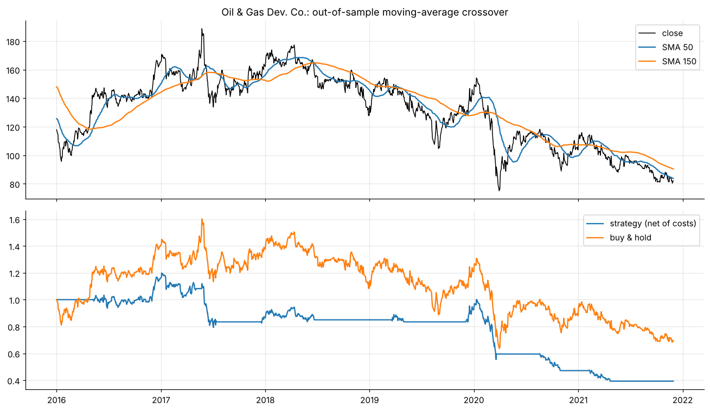

# Pakistan Stock Exchange: risk & moving-average strategies

Six PSX stocks plus Apple: risk, correlation and drawdowns, then dual moving-average strategies with parameters chosen **in-sample** and judged **out-of-sample**, net of costs. Mixed results that show how single-sample backtests mislead.





**Notebook:** [analysis.ipynb](analysis.ipynb) (executed, outputs included)

```bash
pip install -r ../../requirements.txt
jupyter lab analysis.ipynb
```
