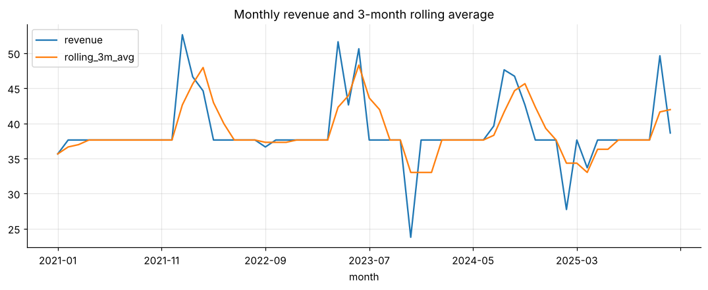

# SQL business analytics (Chinook)

Eight business questions in SQL: revenue by genre and country, running totals and MoM growth with **window functions**, sales-rep ranking, **RFM segmentation**, album-vs-track purchasing and catalogue utilisation.



**Notebook:** [analysis.ipynb](analysis.ipynb) (executed, outputs included)

```bash
pip install -r ../../requirements.txt
jupyter lab analysis.ipynb
```
