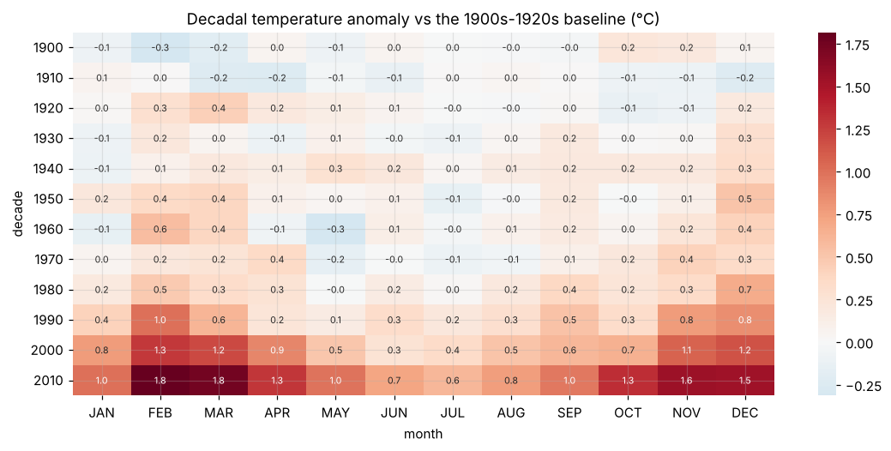

# Monthly temperature trends, 1901-2017

Reshaping, seasonality, warming trend with autocorrelation-robust (Newey-West) CIs: **0.4 °C/century before 1960 vs 2.2 °C/century after**, plus a decadal anomaly heatmap.



**Notebook:** [analysis.ipynb](analysis.ipynb) (executed, outputs included)

```bash
pip install -r ../../requirements.txt
jupyter lab analysis.ipynb
```
