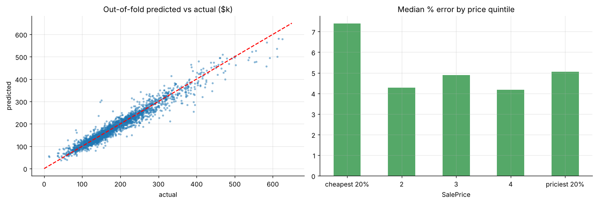
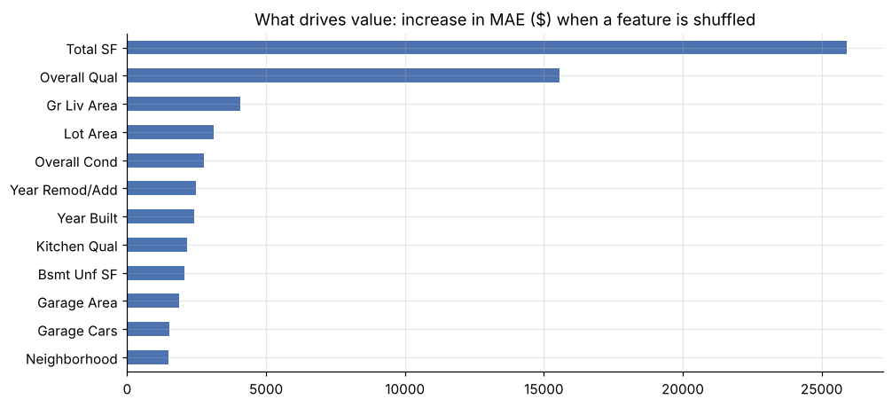

# House-price valuation model (Ames, Iowa)

Automated valuation of 2,930 home sales: ridge, lasso and gradient boosting on log prices with 5-fold CV; **median error ≈ 5%**, 78% of valuations within 10% of the sale price; value drivers and error by price segment.





**Notebook:** [analysis.ipynb](analysis.ipynb) (executed, outputs included)

```bash
pip install -r ../../requirements.txt
jupyter lab analysis.ipynb
```
