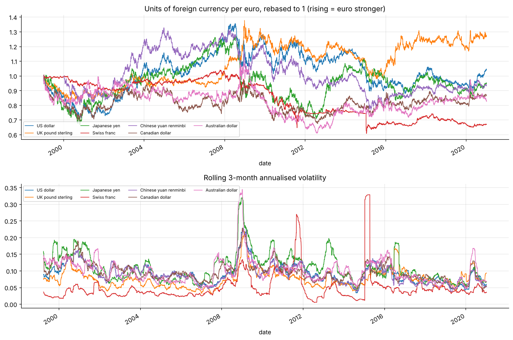
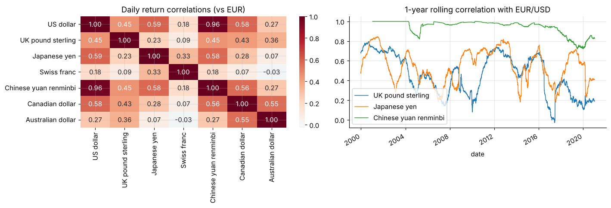

# Currency risk: ECB euro reference rates, 1999-2021

Volatility regimes, correlations and tail events (e.g. the 2015 Swiss franc de-peg), then a 10-day 99% **VaR of a multi-currency receivables book** vs its worst historical loss (about 4-5× larger).





**Notebook:** [analysis.ipynb](analysis.ipynb) (executed, outputs included)

```bash
pip install -r ../../requirements.txt
jupyter lab analysis.ipynb
```
