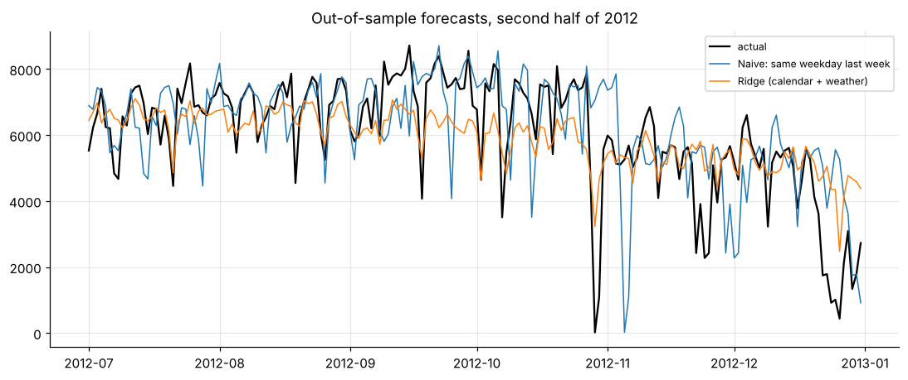

# Demand forecasting: daily bike-sharing rentals

Calendar + weather regression vs seasonal-naive baselines on a 6-month hold-out; **22% lower error than the naive forecast**; why tree models fail to extrapolate growth, and why WAPE beats MAPE.



**Notebook:** [analysis.ipynb](analysis.ipynb) (executed, outputs included)

```bash
pip install -r ../../requirements.txt
jupyter lab analysis.ipynb
```
