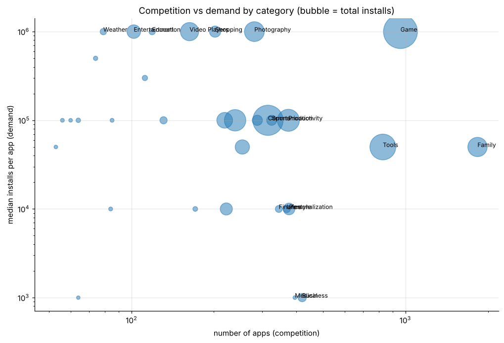

# App-market analysis: Google Play Store

Cleaning messy text fields, then competition vs demand by category, free vs paid economics (paid apps: median 1k installs vs 100k free) and niche opportunities.



**Notebook:** [analysis.ipynb](analysis.ipynb) (executed, outputs included)

```bash
pip install -r ../../requirements.txt
jupyter lab analysis.ipynb
```
