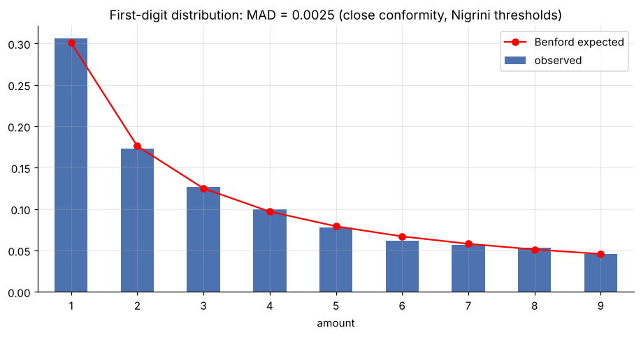
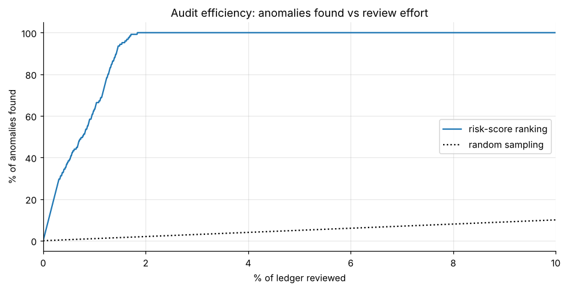

# Audit analytics: journal-entry testing

Full-population GL testing on a **synthetic ledger**: Benford's law, weekend/after-hours/round-amount/below-threshold/duplicate rules and an Isolation Forest risk score. Reviewing **1.8% of entries catches 100% of planted anomalies**.





**Notebook:** [analysis.ipynb](analysis.ipynb) (executed, outputs included)

```bash
pip install -r ../../requirements.txt
jupyter lab analysis.ipynb
```
