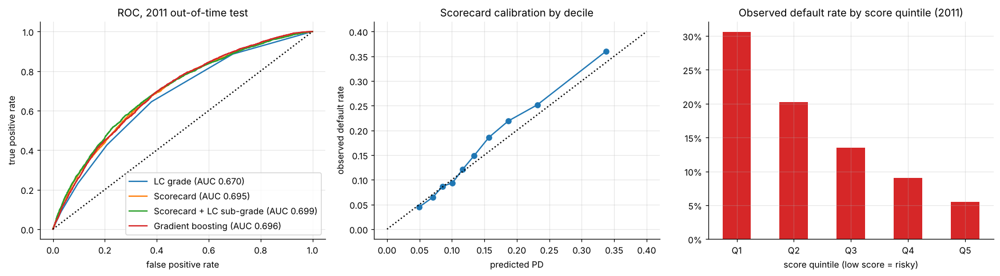
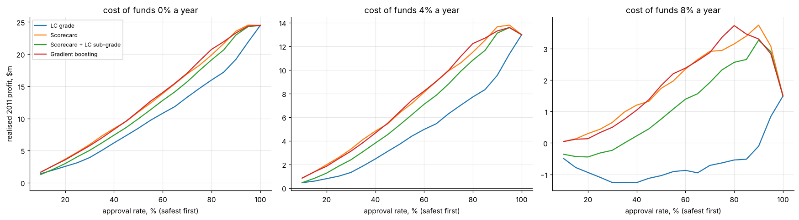

# Credit-risk scorecard: probability of default on LendingClub loans

A bank-style **application scorecard** for 41,519 LendingClub loans (2007-2011). It uses weight-of-evidence binning, information value, a logistic model converted to points, out-of-time validation, PSI monitoring and a profit-based approval cut-off.

* The scorecard uses **application data only** and reaches **AUC 0.695** on the unseen 2011 vintage. That beats LendingClub's own grade (0.670) and matches gradient boosting (0.696), while staying fully explainable (`scorecard.csv`).
* The riskiest score quintile defaulted at about 31%, the safest at about 5.5%. Calibration is close and the population is stable (PSI 0.004).
* At an 8% cost of funds, declining the riskiest 10% by score earns **$3.7m vs $1.5m** for approving everyone. Ranking by LendingClub grade cannot capture this gain.





**Notebook:** [analysis.ipynb](analysis.ipynb) (executed, outputs included) · **Points table:** [scorecard.csv](scorecard.csv)

**Data:** LendingClub loan data 2007-2011 (public loan book), included as `data/lendingclub_2007_2011.csv.gz`. Payment-history fields are used only to measure realised profit, never as model inputs.

```bash
pip install -r ../../requirements.txt
jupyter lab analysis.ipynb
```
