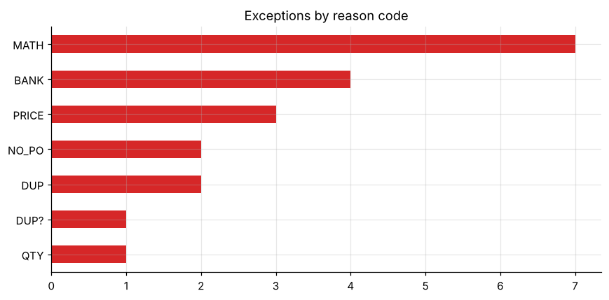
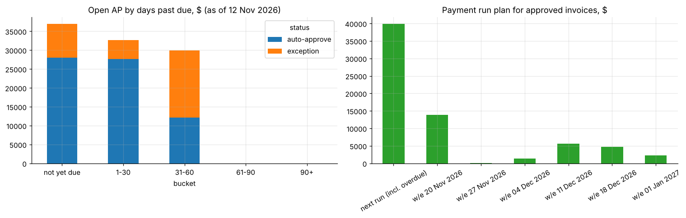

# Accounts-payable automation: invoice PDF extraction, three-way match, exception routing

An end-to-end AP pipeline on **synthetic** invoice PDFs in three vendor layouts. It extracts header fields and line items with `pdfplumber`, validates them against the vendor master, purchase orders and goods receipts, detects duplicates and changed bank details, drafts vendor query emails (`.eml`, never sent) and produces AP aging and a payment-run plan.

* **100% field accuracy** on 75 invoices (8 header fields, 110 line items).
* **All 20 planted problems caught** (arithmetic, price variance, quantity over receipt, missing PO, bank change, three kinds of duplicate) with **no false positives**. **73%** of invoices auto-approve.
* Shows why control rules need tuning: a naive duplicate rule would have flagged 3 legitimate recurring invoices.





**Notebook:** [analysis.ipynb](analysis.ipynb) (executed) · **Data generator:** [make_invoices.py](make_invoices.py) · **Sample drafts:** [outbox/](outbox)

All vendors, accounts and amounts are fictitious; no client data is used.

```bash
pip install -r ../../requirements.txt   # plus pdfplumber, reportlab
python make_invoices.py
jupyter lab analysis.ipynb
```
