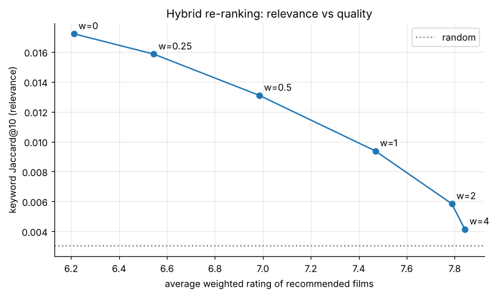
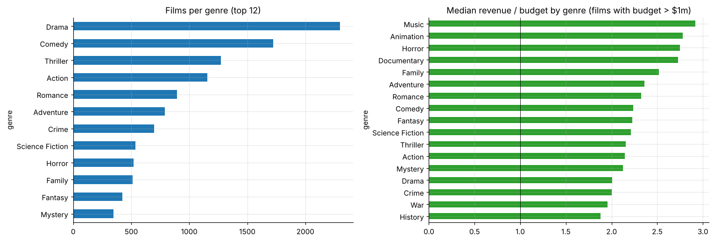

# Recommender system: charts and content-based recommendations (TMDB 5000)

Bayesian weighted-rating charts and content-based "because you watched" recommendations for 4,803 films. It compares plot TF-IDF, a metadata soup (genres, cast, director) and a blend, evaluates them **offline without user data** by holding keywords out of every model, and tunes a hybrid that trades relevance against quality.

* The blended model's recommendations share **5.7×** more held-out keywords with the query film than random picks (popularity baseline: 2.3×); 94% share a genre.
* A quality weight of 0.5 lifts the average rating of recommendations from 6.2 to 7.0 for about a quarter less relevance.

**Notebook:** [analysis.ipynb](analysis.ipynb) (executed). **Data:** TMDB 5000 Movies (Kaggle), trimmed to the columns used, in `data/`. TMDB data is provided by The Movie Database; this project is not endorsed or certified by TMDB.
