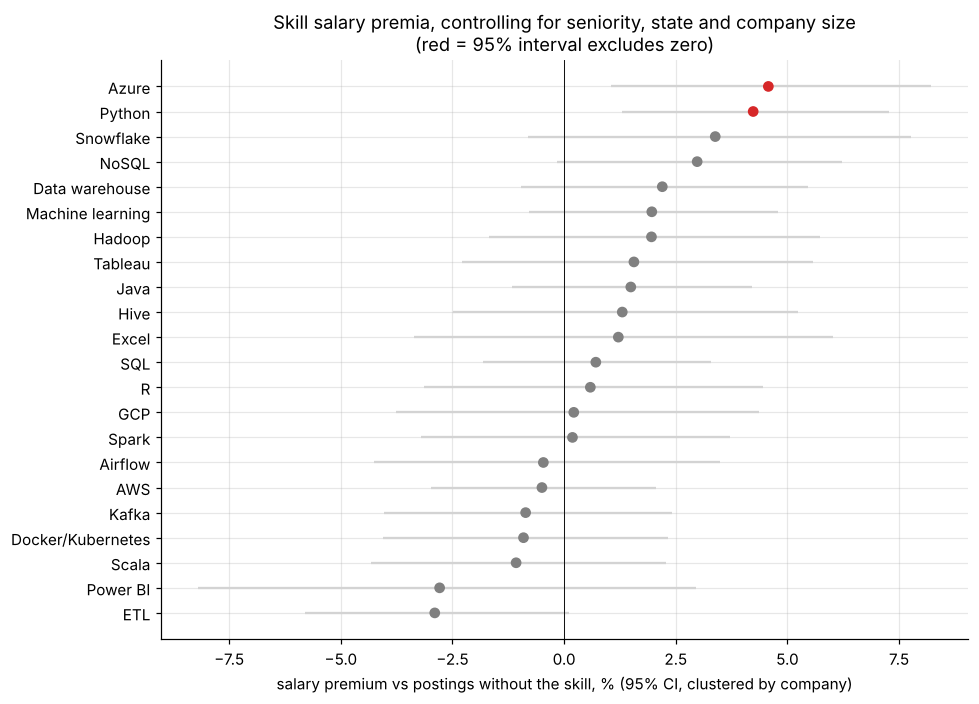
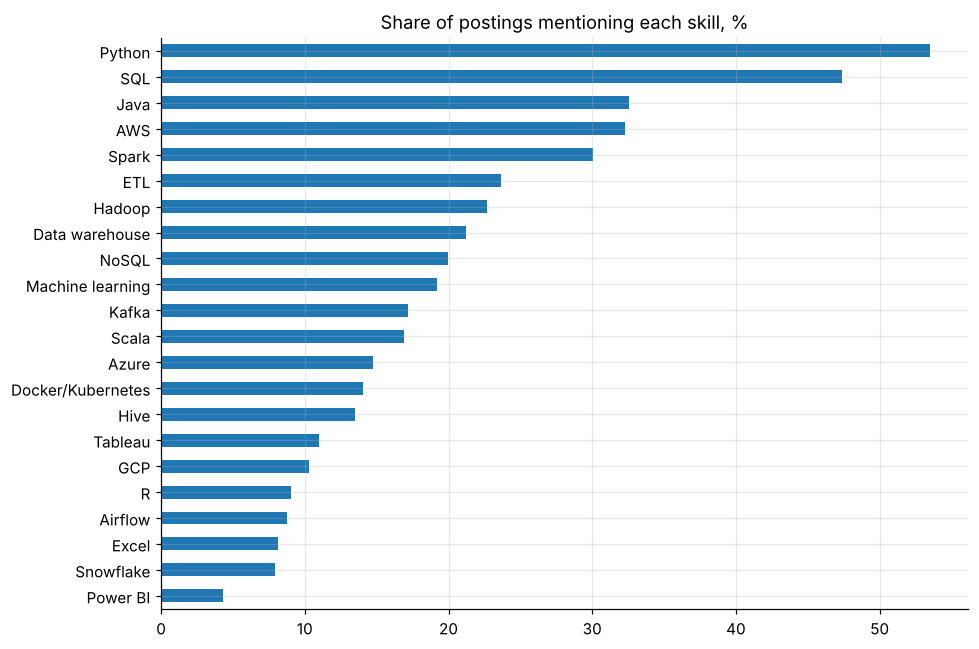

# Data-engineering job market: skills in demand and the salary premia they carry

Text-mining 2,388 unique Glassdoor data-engineering postings: skill extraction from job descriptions, co-occurrence "stacks" and a log-salary regression with company-clustered standard errors that controls for seniority, state and company size.

* Python (53%) and SQL (47%) are the baseline; Java, AWS and Spark appear in about 30% of postings each.
* Only Azure (+4.6%) and Python (+4.2%) show premia whose 95% intervals exclude zero, and neither survives a multiple-testing correction. **Location dominates pay** (CA $128.5k vs TX $87.5k median midpoint).
* Flags a data-quality issue: Glassdoor estimates barely vary with seniority, so skill premia are understated.

**Notebook:** [analysis.ipynb](analysis.ipynb) (executed). **Data:** Glassdoor data-engineer job postings (public Kaggle scrape, c. 2020) in `data/`.
