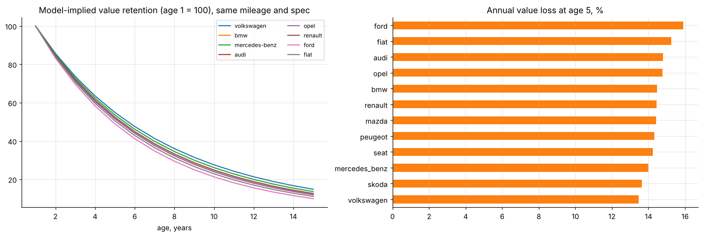
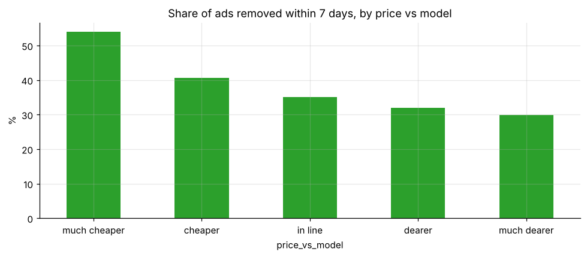

# Used-car marketplace: cleaning messy listings, depreciation, and price vs time-to-sell

50,000 German eBay Kleinanzeigen listings (2016): an auditable cleaning pipeline (24% of rows removed, each rule logged), a log-price depreciation model with brand-specific rates (R² 0.83), and a censoring-aware look at whether over-priced ads take longer to sell.

* Cars lose about **14-16% of value a year at age 5**; Volkswagen, Skoda and Mercedes-Benz hold value best. Unrepaired damage costs 44%.
* Ads priced well below comparable cars are taken down within a week **54%** of the time, against **30%** for ads priced well above.

**Notebook:** [analysis.ipynb](analysis.ipynb) (executed). **Data:** eBay Kleinanzeigen used-car listings sample (public dataset) in `data/`.
