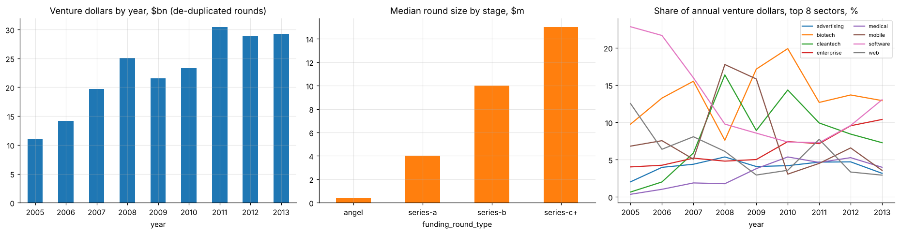

# Venture-funding analytics with data-engineering discipline (Crunchbase 1987-2013)

Processing 52,870 investor-round records as if they did not fit in memory: dtype optimisation (**−90% memory**), chunked aggregation verified against the in-memory result, batch loading into SQLite with indexes, and SQL window functions and self-joins. It then analyses the venture market by year, stage, sector and investor network.

* Catches a **3.3× double-counting error**: the round amount is repeated for every investor ($682bn naive vs $208bn de-duplicated).
* Angel deals grew 26-fold from 2005 to 2012 while Series B stayed flat. SV Angel is the hub of the co-investor network.

**Notebook:** [analysis.ipynb](analysis.ipynb) (executed). **Data:** Crunchbase 2013 investments snapshot (credit: Crunchbase) in `data/`. The SQLite database is rebuilt on each run.
