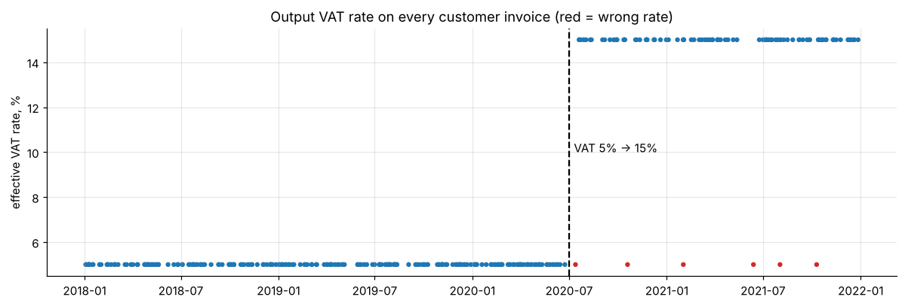
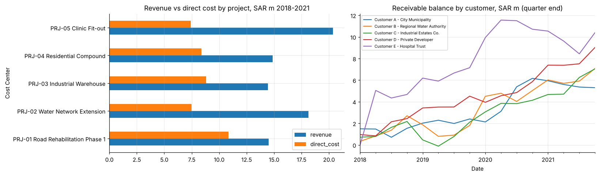

# ERP ledger consolidation: messy exports, VAT checks, PDF reconciliation

Five overlapping ERP general-ledger exports, one in a different Arabic text encoding, consolidated into a single clean ledger. It then checks voucher balancing, the **Saudi VAT change from 5% to 15% on 1 July 2020**, reconciles to the ERP's PDF trial balance, and reports project profitability and receivables.

* Recovers the Arabic narrations that a naive read turns into gibberish, and removes 371 overlap duplicates.
* Finds 4 unbalanced journals, **6 invoices at the old VAT rate (SAR 180,619 under-declared)**, and an invoice dropped by the CSV export, identified from the PDF trial balance.

**Notebook:** [analysis.ipynb](analysis.ipynb) · **Generator:** [make_ledger.py](make_ledger.py)

All data are **synthetic**. They are modelled on the structure of real ERP exports, but every company, customer, account and amount is invented.
