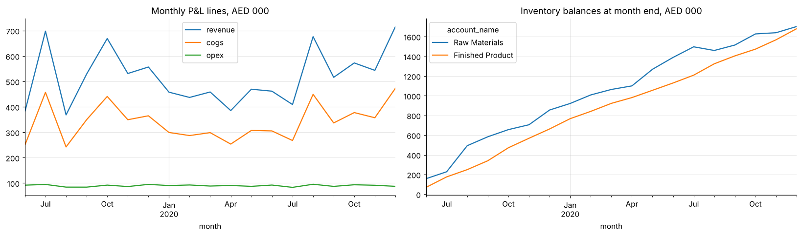
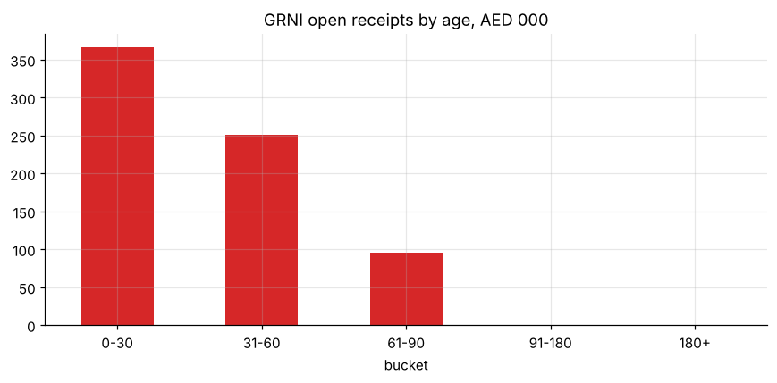

# From an ERP "GL report" to a tidy ledger (SAP Business One export)

Converts the printable SAP B1 General Ledger report (account header rows, offset accounts, running balances, total rows) into a tidy posting-level table. It **proves the conversion is lossless** and uses the result for controls and management accounts: double entry, trial balance, monthly P&L, inventory, DSO and **GRNI (goods received not invoiced) aging**.

* Running-balance and double-entry checks independently catch a **manual edit of AED 143.42** in the export.
* The GRNI balance reconciles exactly to 33 open receipts; 5 receipts aged 61-90 days are flagged for follow-up.

**Notebook:** [analysis.ipynb](analysis.ipynb) · **Generator:** [make_report.py](make_report.py)

All data are **synthetic** (a fictitious UAE manufacturer, AED, 5% VAT). The structure mirrors a real SAP B1 export; no company data is used.
