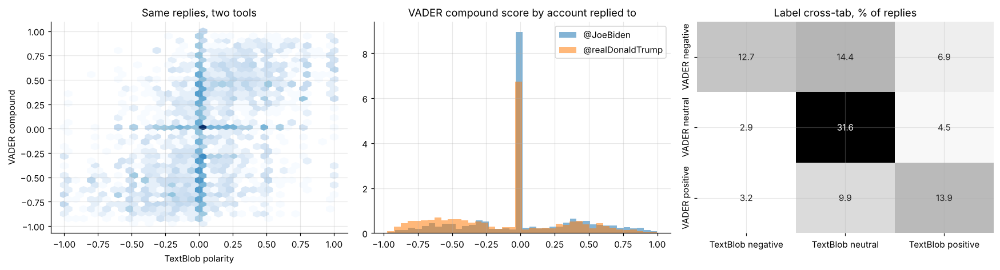

# How reliable is off-the-shelf sentiment analysis? Replies to two politicians' tweets

A **methods** study on 5,328 public replies to @JoeBiden and @realDonaldTrump (c. December 2020). It compares two popular lexicon tools, TextBlob and VADER, measures how far they agree, and shows how the choice of tool changes the conclusion.

* The tools agree on only **58%** of replies (κ = 0.36) and give opposite polarity on 10%. 31% of replies contain no word either lexicon recognises.
* TextBlob shows little difference between the two reply sets; VADER shows a large one. **The finding is an artefact of the measurement tool**, a caution for anyone reporting "sentiment" from social media.

**Notebook:** [analysis.ipynb](analysis.ipynb)

**Privacy and platform terms:** tweet text and user handles are *not* included. `scripts/score_replies.py` scores the raw text locally and publishes only de-identified, shuffled numeric features (`data/reply_scores.csv`). This is a non-partisan methods example; it makes no claim about either politician or public opinion.
