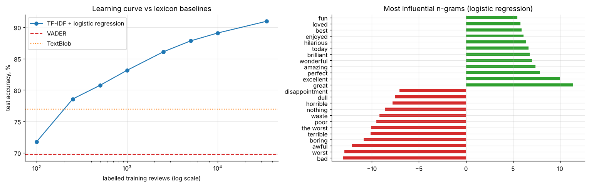
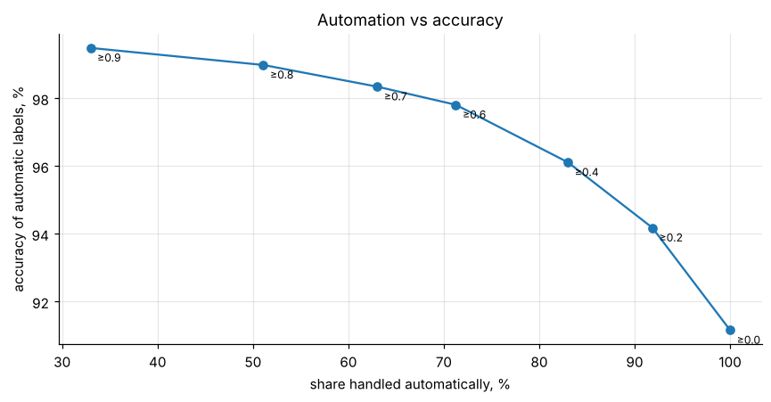

# Customer-review sentiment: lexicon tools vs a trained classifier (IMDB 50k)

Compares zero-training lexicons (VADER, TextBlob) with TF-IDF + logistic regression or a linear SVM on 49,582 reviews. It adds a learning curve (how many labels are needed), interpretable features and a **confidence-based human-in-the-loop** routing policy.

* Trained model **91% accuracy** (AUC 0.97) vs 77% TextBlob and 70% VADER; 250 labels already beat both lexicons.
* Auto-labelling only confident cases handles **71% of volume at 97.8% accuracy**.

**Notebook:** [analysis.ipynb](analysis.ipynb). **Data:** Large Movie Review Dataset (Maas et al., 2011), in `data/`.
