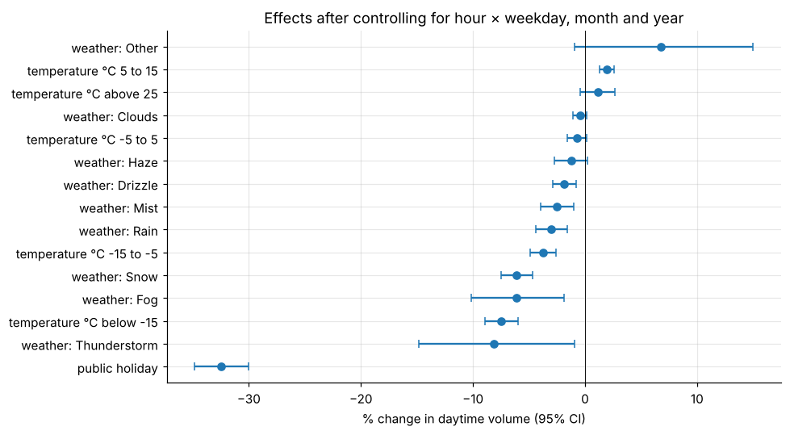
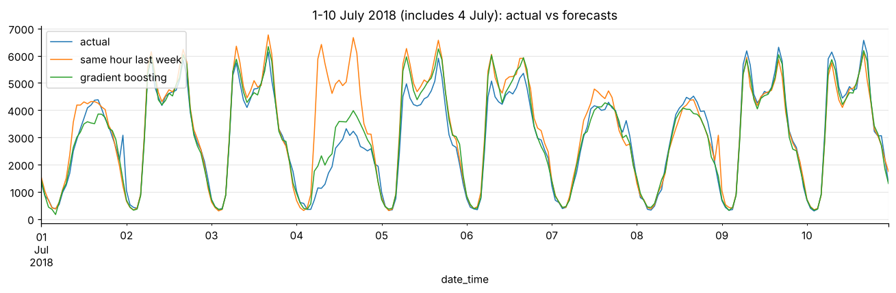

# What drives heavy traffic? Hourly volume on I-94, 2012-2018

Cleans 48,204 hourly traffic and weather records (duplicate timestamps, sensor errors, a year-long gap, holidays flagged only at midnight). It estimates weather and holiday effects **controlling for hour × weekday, month and year**, and forecasts 2018 out of sample.

* A public holiday cuts daytime traffic by **33%**; thunderstorms, deep cold, snow and fog cut it by 6-8%; rain by 3%.
* Gradient boosting forecasts 2018 hourly volume with **6.8% WAPE vs 10.2%** for same-hour-last-week, mainly by handling holidays.

**Notebook:** [analysis.ipynb](analysis.ipynb). **Data:** UCI Metro Interstate Traffic Volume (MN DoT / OpenWeatherMap), in `data/`.
