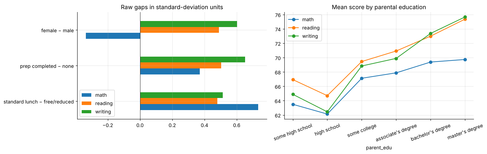

# Student performance: achievement gaps and the test-prep effect

Achievement gaps in standard-deviation units by income proxy, parental education and gender, and the test-preparation effect estimated three ways (raw, regression-adjusted, inverse-probability weighting), with a discussion of when such estimates can be trusted.

* Income-proxy (lunch) gap of **0.73 SD in maths**; opposite gender gaps in maths and in reading/writing.
* Test prep is associated with **+5.5 / +7.4 / +10.1 points** (maths / reading / writing), identical across methods because background barely predicts take-up. That is a property of this teaching dataset, not of real schools.

**Notebook:** [analysis.ipynb](analysis.ipynb). **Data:** "Students Performance in Exams" (Kaggle), a **fictional** teaching dataset, in `data/`.
