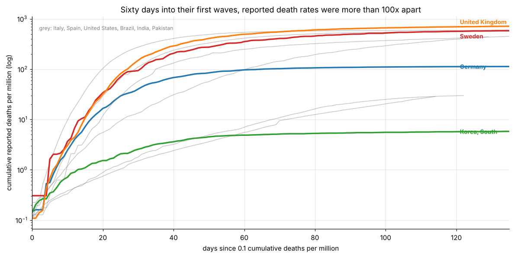
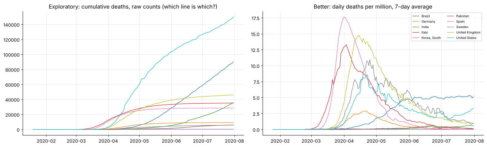

# Data storytelling: from an exploratory chart to an explanatory one (COVID-19, H1 2020)

WHO daily reports for 216 countries joined to Factbook population. It walks through fixing inconsistent country names (83% to 94% matched), per-capita normalisation, smoothing, aligning on outbreak day, and designing a single-message chart.

* 60 days into their first waves, reported deaths ranged from **4.9 per million (South Korea) to 539 (Spain)**, more than a 100-fold spread.

**Notebook:** [analysis.ipynb](analysis.ipynb). **Data:** WHO COVID-19 daily reports (to 31 July 2020); CIA World Factbook population. Both in `data/`.
