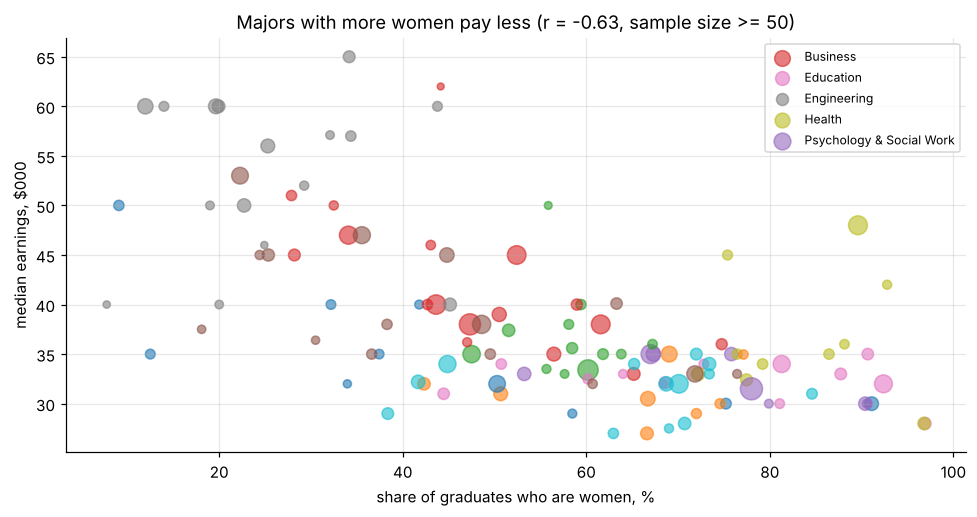

# SQL analytics and relational database design (SQLite)

Three SQL exercises beyond basic `SELECT`: World Factbook analytics with CTEs and window functions; college-major earnings with an **audit that caught a corrupted practice database**; and normalising a 161-column baseball game log (Retrosheet 2010-2016) into a six-table relational schema with integrity checks.

* Audit: 122 of 173 rows in the course database had been altered. The analysis uses the verified source instead.
* Majors: share of women vs median earnings, r = −0.63. Engineering pays most ($56k).
* Normalised schema: 17,007 games, 34,014 team appearances and 391,161 person appearances, with zero orphan keys.

**Notebook:** [analysis.ipynb](analysis.ipynb).

**Data:** CIA World Factbook (SQLite) · FiveThirtyEight college majors (ACS 2010-2012, CC BY 4.0) · Retrosheet game logs. *The information used here was obtained free of charge from and is copyrighted by Retrosheet. Interested parties may contact Retrosheet at www.retrosheet.org.*
