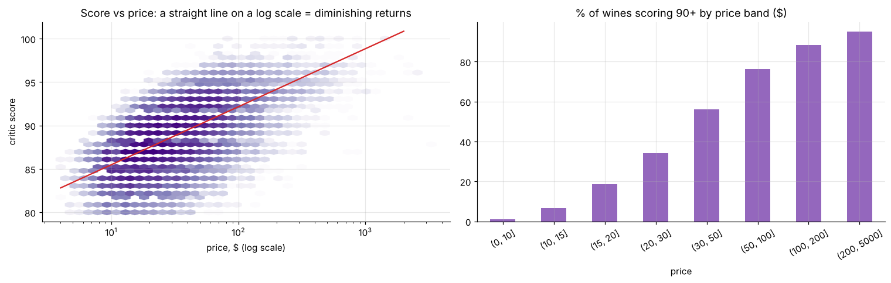
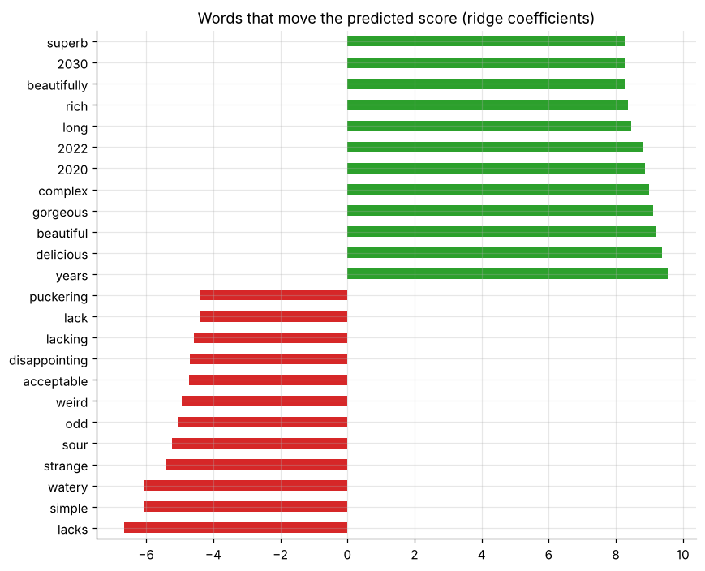

# Does price buy quality? Wine critics' scores, prices, review text and lab chemistry

130k Wine Enthusiast reviews plus 6,497 lab-tested wines (UCI Wine Quality). Covers diminishing returns to price, value-for-money pockets by country and variety, NLP on tasting notes, and chemistry-based quality prediction.

* Each doubling of price ≈ **+2 points**. Austrian and French Riesling and Grüner Veltliner are the best value.
* Tasting-note text alone predicts the score with **R² 0.70** (mean error 1.3 points).
* Lab chemistry explains about half of sensory quality (CV R² 0.49); alcohol is the strongest signal.

**Notebook:** [analysis.ipynb](analysis.ipynb). **Data:** Wine Enthusiast reviews (Kaggle "Wine Reviews", critics' Twitter handles removed) and UCI Wine Quality (Cortez et al., 2009), in `data/`.
