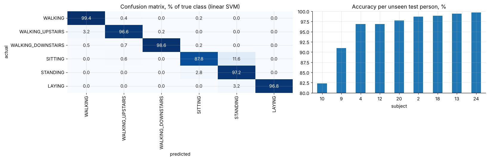
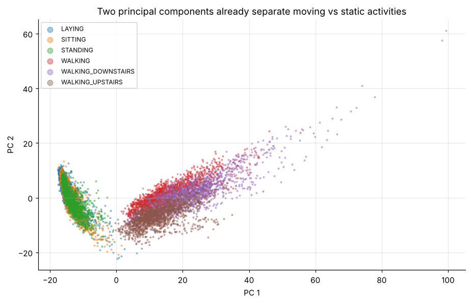

# Human activity recognition from smartphone sensors, and why the validation split matters

Six-activity classification from 561 accelerometer and gyroscope features (UCI HAR, 30 people). It compares models on **people never seen in training**, quantifies the leakage from random splits, and diagnoses the confusions.

* Linear SVM: **96.0% accuracy** on 9 unseen people.
* Random-split CV overstates accuracy by **4.9 points** vs person-grouped CV, a lesson that transfers to any customer- or patient-level model.
* Sitting vs standing is the main confusion (11.6%); per-person accuracy ranges from 82% to 99.7%.

**Notebook:** [analysis.ipynb](analysis.ipynb). **Data:** UCI Human Activity Recognition Using Smartphones (Anguita et al., 2013), in `data/`.
