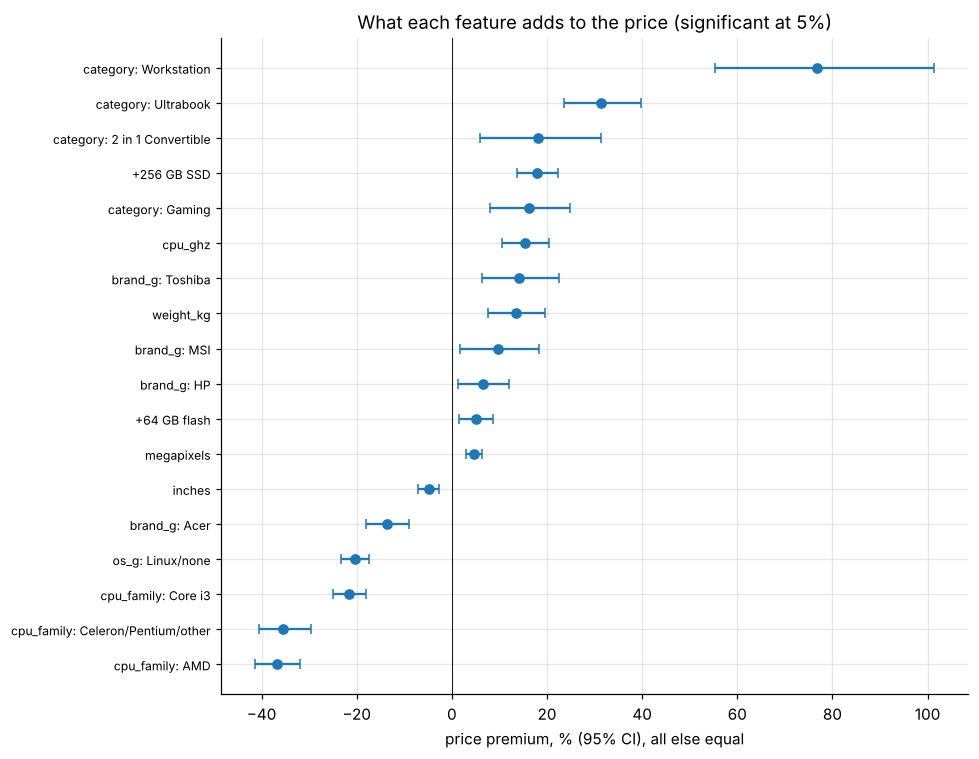

# Laptop pricing: hedonic price model from messy spec sheets

Parses 1,303 free-text laptop listings (CPU, storage combinations, screen resolution, weight, decimal-comma prices) into clean features. A **hedonic regression** (R² 0.84) prices each characteristic, and gradient boosting predicts price within a **median 10.8%** under 5-fold cross-validation.

* Workstation +77%, ultrabook +31%, +256 GB SSD +18%; doubling RAM adds about 27%. Budget CPUs cost 35-37% of value.
* The Apple premium and the Core i7 premium are **not significant** once the specs are controlled.

**Notebook:** [analysis.ipynb](analysis.ipynb). **Data:** "Laptop prices" dataset (Kaggle, European retailer), in `data/`.
