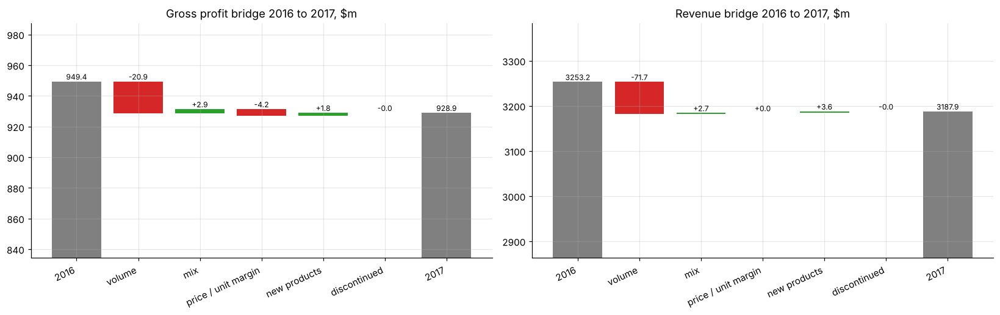
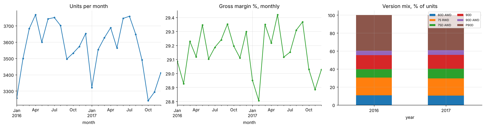

# Why did gross profit change? Price-volume-mix bridge (EV sales 2016 vs 2017)

An FP&A **price-volume-mix (PVM) bridge** on 85,592 vehicle sales across 6 versions and 3 countries. Revenue and gross-profit changes are split into volume, mix, price/unit-margin and new or discontinued products. The decomposition reconciles exactly and is shown as waterfall charts, with segment and country drill-downs.

* GP fell **$20.5m**: −$20.9m from 908 fewer units, +$2.9m from a richer mix, −$4.2m from unit-cost erosion at unchanged prices, and +$1.8m from two new Australian versions.

**Notebook:** [analysis.ipynb](analysis.ipynb). **Data:** an illustrative EV sales teaching dataset (not the manufacturer's reported figures), in `data/`.
