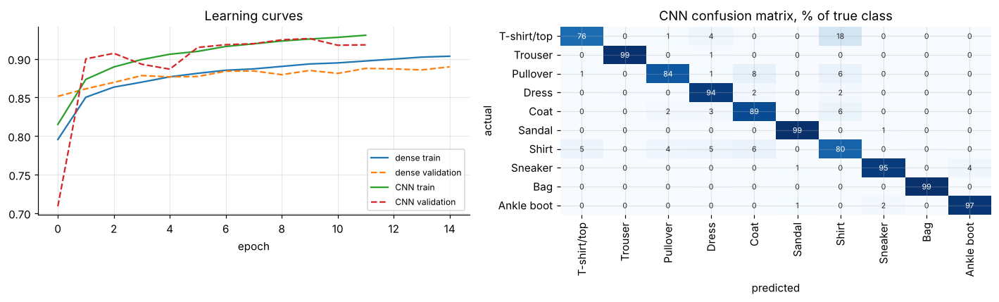
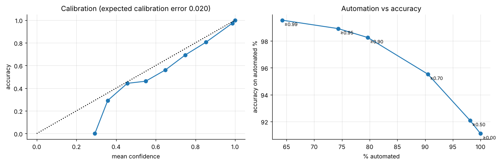

# 31 · Image classification: linear model vs dense net vs CNN

Classifies 70,000 28×28 clothing images (Fashion-MNIST, 10 classes) and asks the business question behind any classifier: **how much of the work can be safely automated?**

| Model | Test accuracy | Parameters | Training time (2 CPU cores) |
|---|---|---|---|
| Logistic regression | 84.5% | 7.9k | 35 s |
| Dense network (256-128) | 88.8% | 235k | 28 s |
| CNN (2 conv blocks, batch norm, dropout) | **91.1%** | 422k | 7 min |

**What the analysis shows**
* Shirts and T-shirts are the weak classes (76-80% recall). Bags, sandals and trousers are recognised 99% of the time.
* Several of the most confident "mistakes" are labelling errors in the data.
* The CNN is well calibrated (ECE 0.020): auto-accepting predictions with confidence ≥ 0.90 covers 80% of images at 98.3% accuracy, and ≥ 0.99 covers 64% at 99.5%.

**Run:** `python fetch_data.py` downloads the data (MIT licence, Zalando Research) into `data/`, then open `analysis.ipynb`. Requires TensorFlow ≥ 2.15 and scikit-learn.

*Reworked from a course deep-learning tutorial: MNIST digits were replaced with the harder Fashion-MNIST, and baselines, calibration and an automation-threshold analysis were added.*
