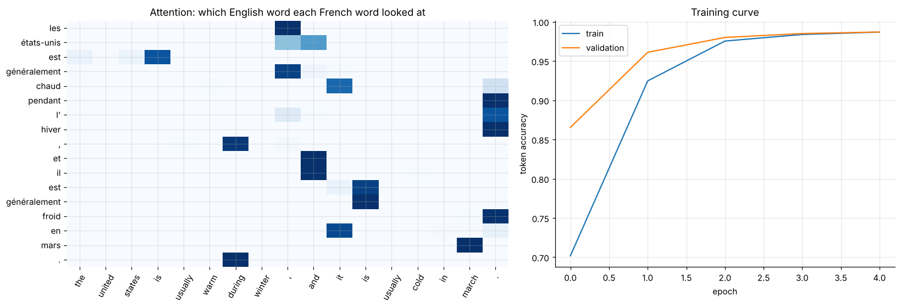

# 32 · Neural machine translation, English → French (seq2seq with attention)

Builds an encoder-decoder translator from scratch in Keras and measures it against a simple word-for-word baseline on 137,860 sentence pairs.

| Model | BLEU | Exact sentence match |
|---|---|---|
| Word-for-word dictionary (Dice co-occurrence) | 43.1 | 0.05% |
| Bidirectional GRU encoder + GRU decoder with attention (614k params) | **95.3** | **82.0%** |

* The test uses 2,000 sentences that do not appear in training. Repeated sentences were removed from the training set first.
* Most remaining differences are valid French (gender agreement, synonyms, word order), so exact match understates quality.
* The attention heatmap is shown, with the caveat that attention weights in a bidirectional model are not a word alignment.

**Notebook:** [analysis.ipynb](analysis.ipynb), about 12 minutes on CPU. **Data:** `data/en_fr_small_vocab.tsv.gz`, the small-vocabulary English-French corpus widely used in teaching (202 English and 352 French words), so results do not generalise to open-domain text.

*Reworked from a course translation tutorial: rewritten end-to-end, with a baseline, a leak-free test split, BLEU scoring and error analysis added.*
