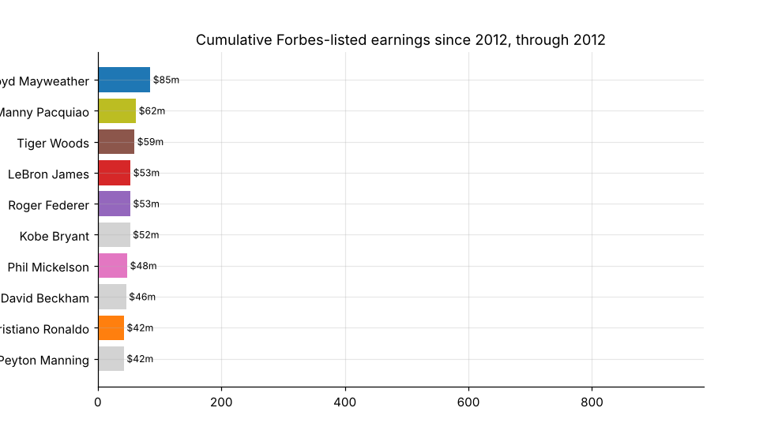
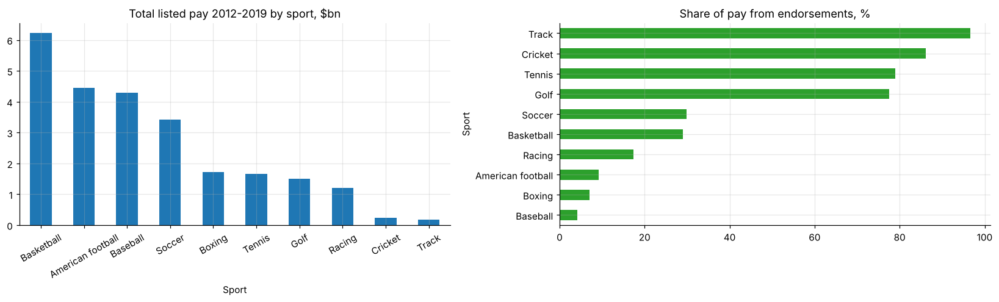

# 33 · Who gets paid in sport, and from where? Forbes highest-paid athletes 2012-2019

Cleans eight years of Forbes "highest-paid athletes" lists (794 entries, 300 athletes) and breaks pay into salary/winnings and endorsements by year, sport and athlete, including an animated "earnings race".

* Total pay for the top 100 rose from **$2.6bn (2012) to $4.0bn (2019)**, and the cut-off to make the list from $16.6m to $25.0m.
* Endorsements are about a quarter of the total, but tennis and golf players earn **~78%** off the field, while baseball (4%) and boxing (7%) earn almost all of it from contracts and purses.
* Mayweather leads cumulative earnings ($853m) with 4% from endorsements. Federer and Woods earn around 90% of their totals from sponsors.

**Notebook:** [analysis.ipynb](analysis.ipynb). **Data:** Forbes lists compiled into `data/` (figures are Forbes estimates, before tax and fees). Amounts quoted in "$ M" and "$ K" are parsed by unit, and one $0 record is dropped. 2014 is excluded from year totals because only 55 names were published.
