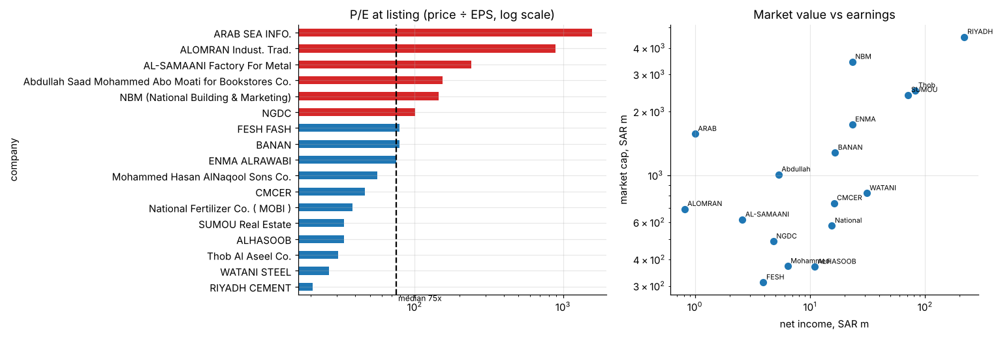

# 34 · Saudi Nomu parallel-market listings: valuation screen with data validation

A first-pass IPO pricing screen on 18 Nomu (Saudi parallel market) listings: P/E at listing, market value against earnings, and advisor concentration. Every number is checked for internal consistency first.

* **8 of 18 records fail at least one consistency check.** Examples: two different EPS figures for one company, a stated P/E that does not equal price ÷ EPS, and a market cap 23% above price × shares. Valuations are recomputed, and the inconsistent figures are listed for verification.
* Median P/E at listing is **75×** (IQR 34×-145×). Only three listings trade at mature-company multiples (21-34×).
* Market value rises with net income at an elasticity of only **0.33**: small earners get the highest multiples.
* One advisor (Falcom) handled 10 of the 18 listings.

**Notebook:** [analysis.ipynb](analysis.ipynb). **Data:** `data/nomu_listings.csv`, compiled from public listing announcements. Confirm figures against each prospectus before use. Not investment advice.
